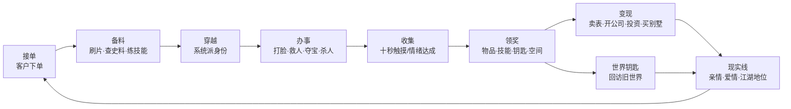

# 《影视世界旅行家》作品分析（第 1–500 章）

> 分析对象：`影视世界旅行家(1-500章).txt`
> 作者：昨夜大雨 ｜ 文本规模：约 125 万字，500 章，平均 2505 字/章（中位 2345 字）

---

## 一、基本盘与阅读前提

这是一部典型的**「影视诸天流」男频爽文**：主角获得一套来自高维文明的"收集系统"，以"接单—穿越—收集—回归—领奖"为循环，逐个进入电影世界完成任务，同时在现代都市里把奖励变现、经营人生。

从文本状态看，这份 txt 是**盗版站抓取的合集**，存在三类非作者问题，需在评价时剔除：

| 问题 | 表现 | 规模 |
|---|---|---|
| 繁简转换不彻底 | 全书统一用「著」「鬆」「麵」「傢伙」，无一处「看着」 | 「看著」888 次、「傢伙」1189 次 |
| 站点水印插入 | "（请记住 超好用…网站）""记住我们网"等广告行嵌在正文中间 | 43 处 |
| 章节体例错位 | 每章标题下重复一行上一章标题且编号 −1；末章标"第500章"、正文写"第499章" | 374 处 |

另有 **8 处主角名误植为"秦观"**（第 3 章一处直接写成"秦观道"，与后文反复出现的祈祷语"三清道祖、秦观帝君"同源，疑为作者旧稿残留或输入法联想）。这些属于文本瑕疵，但"秦观道"这种主角名滑脱，客观上会破坏读者的沉浸感。

---

## 二、主要内容：一个"宇宙版外卖员"的接单人生

### 2.1 设定：把"观影欲望"做成生意

第 1 章，江浩还是个卖不出保单、卡里只剩 800 块、连房租都交不起的二本毕业生。系统在此时降临，给出的解释极其"商业化"：

> 第二宇宙文明把地球电影发回本土，有人看了想买"周边"，就在平台下单；江浩负责进入电影世界，替客户收集**物品**或**感受**。

于是有了那句定调全书的话——"这更像是一份**私人订製**业务"。

这套设定的聪明之处在于：**它把"读者看完电影后的那点念想"直接写成了故事的发动机**。客户要一百只《美人鱼》里的烤鸡、一百坛《红高粱》的酒、一份《食神》的"美食滋味"、一段《荒岛余生》的"孤独"、一次《无间道》的"卧底体验"——这些订单本身就是观众心理的具象化。读者不是旁观江浩冒险，读者就是那个下单的人。

### 2.2 规则：前期严谨，后期松动

开篇的说明书立了四条硬规矩，这是全书张力的地基：

1. 收集需手掌接触物品、持续十秒；
2. 实体穿越，会受伤、会死，"灵魂消亡就是真正的死亡"；
3. **不能从电影世界带走任何物品**，回报只能靠系统随机奖励（物品或技能）；
4. 任务可拒接，失败则随机扣除一项已有奖励。

第 169 章拿到"世界钥匙"后，规则第一次扩容：可回到已完成的世界，一年一次、每次三个月、**消耗自己的寿命**、仍不能携带物品。第 454 章再拿到"黄金空间"，规则第二次扩容：金银货币可转化为黄金、吸收后扩张空间体积——**"不能带走物品"这条最核心的限制，至此被彻底绕开**。

### 2.3 十四个世界的弧线分布

| # | 世界 | 章节 | 章数 | 任务内核 |
|---|---|---|---|---|
| 1 | 美人鱼 | 1–5 | 5 | 一百只烤鸡（开篇立规矩） |
| 2 | 红高粱 | 7–26 | 20 | 一百坛高粱酒；杀匪、护九儿 |
| 3 | 食神 | 30–51 | 22 | 收集"美食滋味"，厨艺对决 |
| 4 | 新宿事件 | 55–93 | 39 | 收集"拼搏"；华人帮派、投资软银 |
| 5 | 现实线（拒接《断背山》） | 94–101 | 8 | 喜剧插曲，展示"可以拒单" |
| 6 | 荒岛余生 | 102–127 | 26 | 收集"孤独"，硬核求生 |
| 7 | **西西里的美丽传说** | 128–170 | 43 | 保护玛莲娜，改写悲剧 |
| 8 | 红高粱（回访） | 171–176 | 6 | 世界钥匙首用，兑现旧情 |
| 9 | 海豚湾 | 177–204 | 28 | 救一万只海豚，武装对抗捕鲸船 |
| 10 | 玉蒲团 | 205–261 | 57 | 夺宁王宝物百件，入明朝江湖 |
| 11 | **无间道／古惑仔** | 262–390 | 129 | 体验卧底，做到东星龙头 |
| 12 | 荒野大镖客（西部大乱入） | 391–462 | 72 | 攒"抢劫值"，做到洛杉矶副市长 |
| 13 | 铁血战士 | 463–471 | 9 | 战胜三名铁血战士 |
| 14 | 金陵十三钗 | 472–500 | 29 | 杀戮值一万，收集罪证送美 |

两处结构性事实值得注意：

- **弧长与金手指同步膨胀**。开篇 5 章解决一单，中期 43 章，港片弧一口气吃掉 129 章（全书四分之一）。原因不复杂：能力越强，"装逼的舞台"就得越大——从一只烤鸡摊，到一个社团、一座城、一个时代。
- **第 500 章是断点，不是终点**。全书停在胡适刚接下照片与胶片、准备游说美国议员处，任务未结算，故事未收束。这是连载文本的前 500 章，不是完整作品。

---

## 三、核心主题

### 3.1 匮乏者的补偿幻想

第 1 章给出的所有数字都是精确的：卡里 800 块、房租 1100、一交一季度 3300、刚给家里打了 3000。江浩此后所有的选择——卖表、倒货、投资、买别墅——都能回溯到这几个数字。**这本书真正的主题不是"穿越"，是"脱贫"**：让父亲看得起病、弟妹读得起书、自己在亲戚面前抬得起头。

所以第一个任务奖励江诗丹顿，他的第一反应不是收藏，是去典当行；被压到 12 万，他扭头就走；最后 35.8 万成交。半年后又花 39.5 万买回来，"那毕竟是自己的第一份奖励"。这段写得比后面所有打斗都好，因为它写的是**人对钱的真实肌肉记忆**。

### 3.2 "如果我在场"——对悲剧文本的情感代偿

这是全书最动人的一条线。作者挑的世界有个共同点：**原作里都有一个无法挽回的遗憾**。

- **玛莲娜**（43 章，全书最用力的一个弧）：作者先用整章篇幅复述她被造谣、被剥夺、被律师侵犯、被全镇妇女当街撕打的命运，然后下判断——"人们根本不爱美丽，美丽是不被原谅的，美丽是用来被蹂躏的"。他甚至否定了原片结尾那个"被小镇接纳"的温情收束："扯淡！全他妈扯淡！他们亲手毁了她，现在她变得枯萎了，人们又来展现同情心。"——**先替读者把愤怒说完，再让主角进去改写**。这是整本书情绪效率最高的写法。
- **九儿**：明知几年后日军会来，他卖掉酒坊、给罗汉两成干股（"这相当于高薪聘请 CEO"）、带着全伙人迁往川蜀。离别那章标题就叫"这一离开，便是永别"，他清楚电影世界是单程票，"这一切终究是一场虚幻"，但还是要把人安排好。
- **海豚湾**：太地町的血水、国际捕鲸委员会的禁令形同虚设，作者用纪录片式的资料铺陈完，让江浩开着船去撞。

**这就是此类文的核心快感机制：不是"我比你强"，而是"我在场，所以悲剧不必发生"。**

### 3.3 观看者成为参与者：一层元叙事

系统的商业模式是"高维观众看电影→下单→派人进去取货"。这个结构本身就是对读者的隐喻：我们也是坐在屏幕外、对电影里的烤鸡和姑娘念念不忘的人。江浩在电影世界里反复吐槽剧情、评价演技、抱怨"这电影不咋好看"（第 391 章评价《荒野大镖客》），甚至在第 473 章直接写了个"主角猝，全书完！"的章节名——**作者始终没让读者忘记"这是电影"**。这种自觉，是本书比同类作品高一档的地方。

### 3.4 从消费主义到民族记忆：一次剧烈的主题换挡

前 460 章的主题是"过好日子"：吃、赚、泡、装。到第 472 章《金陵十三钗》，画风骤变——江浩裸身穿拖鞋落在 1937 年 12 月的南京，用木棍捅爆日军士兵的头，系统提示"杀死一个日本兵，获得杀戮值 1 点"，他关掉提示音："从现在开始，不用什么系统提示了，只要老子不死，就在这个位面杀他个天翻地覆。"

此后是杀人、扒军装、抢黄金、去日本、把南京大屠杀的照片和胶片送到驻美大使胡适手上。作者写这一段是真诚的——书架上那排《南京保卫战》《徐州会战》《远征印缅抗战》，那句"忘记历史，就意味着背叛"，都不是敷衍。但**把民族创伤换算成"杀戮值 10000"的任务进度条**，这种游戏化的处理方式，与题材本身的重量之间存在明显错位。这是全书最需要读者自行分辨的部分。

### 3.5 一条隐性的"自我修养"线

散在各章之间的，是作者借江浩之口输出的处世哲学：抄《曾胡治兵语录》讲"未来不迎，当时不杂，即过不恋"；给学员上课绝不搞暧昧，"做人要有底线，有夫之妇决不能碰"；天天晨跑、健身、买书、学语言。**在一个以"爽"为卖点的文本里，反复强调自律、读书、克制**，这是作者一点朴素的诚意，也是江浩这个人物没有彻底滑向"人形自走外挂"的原因。

---

## 四、人物塑造

### 4.1 江浩：扁平，但有底色

他的性格配置很标准：农村出身、能吃苦、脑子活、脸皮厚、关键时刻有底线。功能上他是"读者替身"，缺什么补什么。

但有两处写得超出类型平均线：

1. **钱的反应是真的**。第 4 章刘轩甩出十万支票，他心里想的是"十万块可以让父亲去更好的地方看病，可以让母亲不必为生活担忧"，嘴上却喊"你以为十万块就可以收买我的灵魂吗"——因为他知道这钱带不走。**心里一套、嘴上另一套，且作者把两套都写出来**，这种坦白反而让人物立住了。
2. **他会算账，也会怕**。进荒岛前先算"任务失败只扣一项奖励，没什么比命重要"；进铁血战士世界前先逐帧研究电影，找出"冰与火可以破红外"的破绽。**谨慎是这个主角最不像爽文主角、也最可信的特质。**

缺点同样明显：他的能力表是无限叠加的——过目不忘、千杯不醉、动物沟通、多国语言含日本各地口音、枪法、格斗、开锁、厨艺、符箓道术、黄金空间。到后期，**没有任何一场危机能真正威胁到他**，"危险"全靠作者在旁边喊"这次很危险"。

### 4.2 女性群像：三种功能，一个例外

| 角色 | 出处 | 叙事功能 | 完成度 |
|---|---|---|---|
| 九儿 | 红高粱 | 乡愁与道义（"我是你男人"） | 较好，有生活质感 |
| 玛莲娜 | 西西里 | 美的受难与拯救 | 最好，作者投入了真感情 |
| 铁玉香 | 玉蒲团 | 温柔乡、欲望 reward | 单薄，功能化明显 |
| 周欣妍 | 现实线 | 慢热爱情、都市归属 | 类型内罕见的"有过程" |

**周欣妍是全书最特别的一个角色**：30 岁、科技公司行政主管、没谈过恋爱、会为一条视频兴奋到发朋友圈、会问"我们是在你那边住还是我这边住"。这条感情线铺了近 400 章才接吻，中间夹着晨跑、接机、见家长、搬家、买床单。在一本以"即时满足"为底层逻辑的书里，**唯一被耐心对待的，恰恰是唯一不能用系统奖励换来的东西**。这个反差是有意还是无意不好说，但效果很好。

反面是：其余女性大多停留在"被拯救—倾心—以身相许"的流水线上，外貌描写也常滑向物化（"挺翘的臀部一摆一摆"）。这是类型局限，也是这本书天花板所在。

### 4.3 配角与反派：工具人流水线

- **反派**：刘轩（嚣张富少）、马苏（嘴毒女同事）、秃三炮（土匪）、笑面虎（阴险坐馆）——基本是"先轻蔑、再被碾压"的标准件，智商普遍不足以构成威胁。
- **兄弟／手下**：罗汉（忠厚大掌柜）、苏威阿深细 b 仔（古惑仔三小弟）、程博（健身馆伙伴），功能性很强，但偶尔有生动笔触（罗汉谈"两成份子"时的迟疑）。
- **动物配角**：小百灵（会用"啾啾啾"表达"我是爱干净的好孩子"，还学会了狗叫）、三只黄大仙、画眉鸟。**这是全书最松弛、最有生活气的部分**，也是作者写"日常"比写"战斗"更好看的证据。

---

## 五、情节结构与叙事手法

### 5.1 单元剧 + 双线正反馈闭环

这个闭环是本书的骨架，也是它最大的问题来源：**每一环都成立，但每一环都不推进"总剧情"**。全书没有终极对手、没有系统之谜的揭晓、没有收集员之间的竞争、没有"第二宇宙"的真身。悬念只在章末存活，下一章就被消费掉。

### 5.2 节奏配方

- **备料段（约 1–3 章）**：看片、查资料、买书、练枪、和家人吃饭。既是考据展示，也是"水"的主要来源。
- **进入段（1 章）**：落地即危机——飞机失事、街头砍杀、裸身落在南京。**这是作者最稳定的手艺**，开局从不拖沓。
- **高潮段（3–10 章）**：打脸、救人、火并、决战。
- **结算段（1–2 章）**：领奖、吐槽奖励、回现实炫耀。

爽点密度大致符合"每 1–2 章一个小爽点、每 3–5 章一个中爽点、每弧一次大高潮"的网文标准，但**同质化严重**：爽点类型高度集中在"当众打脸"和"降维碾压"两种，缺少"智斗""布局""反转"。

### 5.3 叙事视角与声音

- **第三人称限定视角 + 高密度内心独白**。叙事几乎全程贴着江浩，读者的信息量等于他的信息量，代入感强，但**其他角色的内心基本空白**——周欣妍的心理要靠"她忽然脸红了起来"这类外部描写硬撑。
- **作者频繁"越界"**。章末常有"（本章完）"后紧跟一句议论、一句牢骚、一句资料补充。有时是知识科普（熊本第六师团、三八大盖、1943 年美军攻占西西里），有时是价值判断（"民众，选举前是大宝贝，选举后就是狗屎"）。**这种"说书人"腔调是优点也是噪音**：它让文本有温度、有信息量，也让它经常在关键时刻跳出戏外。
- **互文与玩梗**：引用《红楼梦》式的诗句调情（"身无彩凤双飞翼"）、拿"熊本熊"反讽第六师团、拿《兽血沸腾》的"刘震撼袜子"开涮、拿"三秒男"开黄腔。**梗的密度很高，但不少梗有年龄感**，十年后重读会失效。

### 5.4 章末钩子的技术

绝大多数章节的收尾靠三招：系统提示音（"叮——"）、一句立场宣言（"从现在起我只做一件事，杀！"）、一个突兀的来电/来客。**有效，但可预测**。真正的悬念型钩子（信息差、身份暴露、两难选择）用得很少，最典型的一次是第 368 章江浩在黄警司保险柜里翻到自己的卧底评估报告——"此卧底人员有随时变节可能"——这是全书少有的、让人后背发凉的钩子。

---

## 六、语言风格与写作特点

### 6.1 可量化的特征

| 指标 | 数值 | 说明 |
|---|---|---|
| 平均段长 | 37.9 字 | 极短，适配手机竖屏阅读 |
| ≤12 字的段落占比 | 19.6% | 大量"单句成段"制造节奏 |
| ≥50 字的段落占比 | 30.9% | 说明并未放弃描写 |
| "呵呵" | 397 次 | 作者的万能语气词 |
| "其实" | 307 次 | 转折与解释的默认开关 |
| "耸耸肩" | 50 次｜"淡淡一笑" 40 次 | 重复的肢体标签 |

### 6.2 三个鲜明手法

**（1）短句爆破 + 单句成段。** 紧张处几乎一句一段：

> 刷~~~
> 江浩的身体消失在房间内。
> 下一秒，
> 江浩只觉自己身子在剧烈晃动。

这种排版在纸面上显得破碎，在手机上却极其"跟手"。它不是文学技巧，是**媒介技巧**。

**（2）市井化的比喻与自嘲。** 全书最好的幽默都来自"把宏大事物拽到菜市场"：

> "就好比买一袋恰恰瓜子，从中国包机空运到美国，运费得有多贵。"
> "自己这是要成为外卖小哥的节奏吗，还是宇宙版外卖小哥。"

**（3）反差式喜剧节奏。** 江浩的固定套路是"先大义凛然，再立刻投降"：拒绝一万、拒绝十万、拒绝百达翡丽级别的江诗丹顿——最后指着刘轩喊"我告诉你，你~~赢~~了！"**这种自拆台的写法，是这本书最有效的解腻剂**，让"装逼"这件事不至于太难看。

### 6.3 语言的失分处

- **套话密集**："心里就是一动""嘴角勾起一抹弧度""不得不说""说白了"，读三百章后会形成"阅读疲劳的固定音高"。
- **对话辨识度低**：除了九儿的方言感和笑面虎的阴阳怪气，多数角色说话是同一个腔调——**都是作者的腔调**。
- **情绪靠形容词堆**："无比震惊""骇然""心中掀起惊涛骇浪"，而非靠动作与细节。
- **数据流癖**：喜欢精确到个位（12 万、14.6 万、35.8 万、39.5 万、两成干股、180 发子弹）。这既是考据癖的可爱之处，也常常变成"炫学"。

---

## 七、优缺点评估

### 优点

1. **设定有原创性**。"观众下单、代购穿越"的商业模式，把类型文的元叙事做成了情节本身，比"系统发任务"高一个层次。
2. **情感代偿写得真**。玛莲娜、九儿、海豚三个弧线，证明作者在"改写遗憾"这件事上有真本事，尤其玛莲娜弧的整章影评式铺垫，情绪推得极稳。
3. **考据扎实**。西西里 1941–1943 的时间线、日军第六师团的熊本编成地、三八大盖与 98k 的差异、太地町捕豚的利益链、90 年代软银的投资窗口——这些细节让"穿越"有了重量。
4. **节奏控制专业**。开局即危机、章末必留钩、每弧必有高潮，是成熟连载作者的肌肉记忆，很少出现连续三章无爽点的情况。
5. **主角有可信的成长弧**。从"800 块"到"洛杉矶副市长"，路径虽然夸张，但每一步的动机都能对上第 1 章那张长椅。
6. **周欣妍这条线是意外之喜**。在一本快消品里，花了近 400 章谈一场"晨跑—接机—见家长"的恋爱，罕见且有效。

### 缺点

1. **无主线，无终局**。500 章过去，系统是谁、为什么选他、"第二宇宙"想干什么，一个字没推进。**读者读完 500 章，等于读了 14 个加长版短篇。**
2. **金手指通胀，危机感归零**。"不能带走物品"这条最硬的规则，在第 454 章被"黄金空间"溶解；能力表叠到十项以上后，任何敌人都只是"经验包"。**作者用"这次很危险"的旁白替代了真正的危险**。
3. **反派集体降智**。打脸对象从富少到黑帮老大，智力水平长期停留在"先嘲讽、后被碾压"，导致爽感边际递减。
4. **女性书写工具化**。九儿、玛莲娜、铁玉香的功能高度重合（被救—归属—奖赏），身体描写常越界。
5. **价值观需要辨析**。"以黑治黑"（海豚湾组织武装撞船）、"以暴易暴"（金陵弧的杀戮值）、"金钱万能"（投资软银、操纵股市），在爽感层面有效，在价值层面粗糙。**尤其把民族创伤换算成任务积分，情感是真挚的，方法是可疑的。**
6. **主题换挡过猛**。从"私人订制"的轻喜剧，直切"杀杀杀"的血仇叙事，中间没有过渡带，读感上是两本书。
7. **文本层面的硬伤**：主角名"秦观"误植 8 处、章节编号错位 374 处、广告水印 43 处、繁简混排。虽是盗版文本问题，但直接影响阅读。

---

## 八、值得关注的亮点（如果要续写、改编或研究）

1. **"订单"作为叙事引擎**。这是本书最可复用的创意资产。任何"观众想要什么"都可以变成一单任务——比"系统随机发布任务"自由得多，也天然带喜剧性。续写时可以把订单设计得更"刁"：不是要一件东西，而是要一种"结果"（让某个人活下来、让某句话被说出口）。
2. **"十秒触摸"这个限制**。它逼出了大量机智桥段（怎么在众目睽睽下摸一百只烤鸡、怎么把一百坛酒运到川蜀再收）。**限制越具体，戏越好写**——这是本书最好的一课。
3. **世界钥匙的"寿命成本"**。一年一次、每次三个月、消耗自己的寿命——这是全书唯一带有悲剧性的设定，可惜只用了一次（回红高粱看九儿）。这个设定若被充分开发，足以支撑一条"长生与代价"的主线。
4. **三个固定世界的"家庭"结构**。九儿在民国、玛莲娜在二战西西里、铁玉香在明朝——**三个时代、三个妻子、三种活法**。这是本书最接近"文学"的构想：一个现代人如何在三个时空里分别承担丈夫的责任。
5. **金陵弧的历史材料处理**。作者列出的那串书名、"忘记历史就意味着背叛"、把照片和胶片送到驻美大使手上——**这条"用影像作证"的思路，其实比"杀一万个"高级得多**。如果重写，把重心从"杀戮值"移到"取证与传播"，这个弧会立刻从爽文升格为历史小说。
6. **小百灵与动物沟通**。这是全书最被低估的设定：一个能和动物说话的人，在谍战、侦查、追踪里的价值远超枪法。作者只用它来卖萌和偷档案，浪费了。

---

## 九、一句话结论

**这是一部设定聪明、情绪真诚、手艺熟练，但结构上"只有单元、没有整体"的类型佳作。** 它最动人的时刻不是打脸，而是江浩在酒窖门口对九儿说"咱们离开吧"，是他在玛莲娜睡着时轻轻吻她的脸然后被系统强制召回——**一个永远只能做客的人，反复练习告别**。这个母题，比"杀戮值一万"值得写得多。

---

### 附：类型定位速览

| 维度 | 评价 |
|---|---|
| 类型 | 影视诸天流 · 都市爽文 · 单元剧 |
| 目标读者 | 18–35 岁男性，熟悉 90 年代—2010 年代华语/好莱坞电影 |
| 阅读门槛 | 极低（短段、快节奏、无门槛设定） |
| 同类差异 | 优点是"订单制"元叙事与考据；短板是无主线、金手指失控 |
| 适读方式 | 跳读单弧最佳；玛莲娜弧（128–170）、荒岛弧（102–127）、港片弧（262–390）为三个高地 |
| 改编建议 | 更适合做单元剧集而非长片；玛莲娜弧可独立成篇 |
